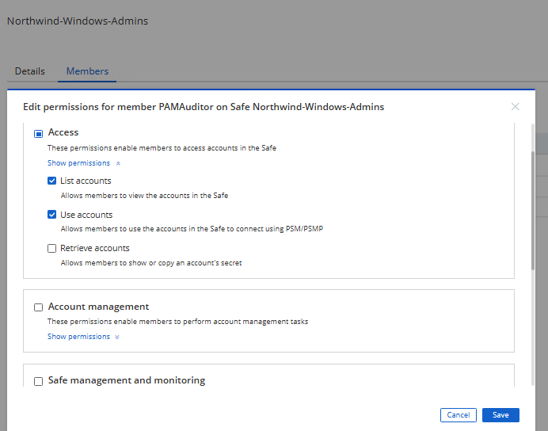
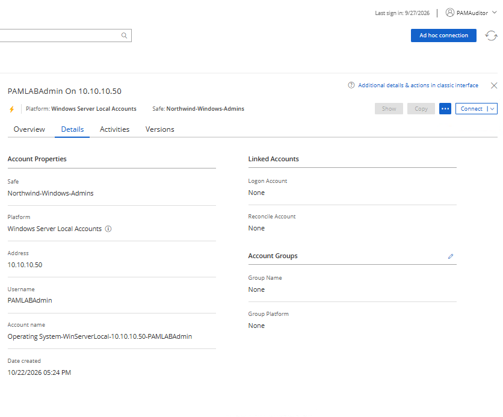
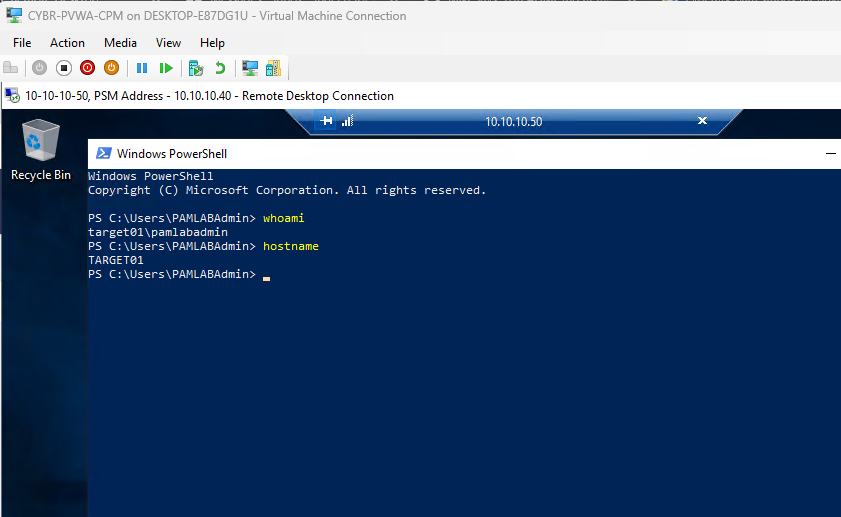
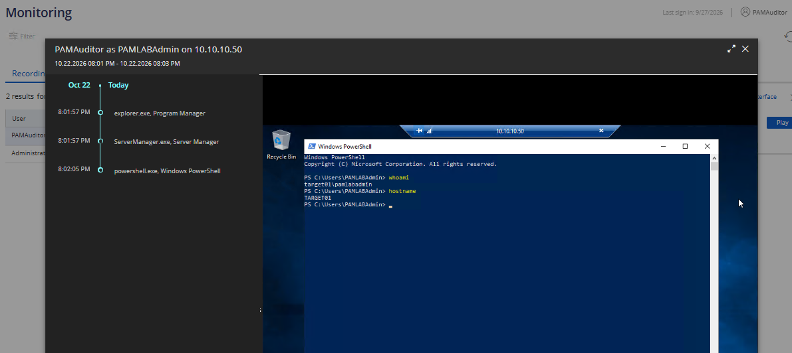
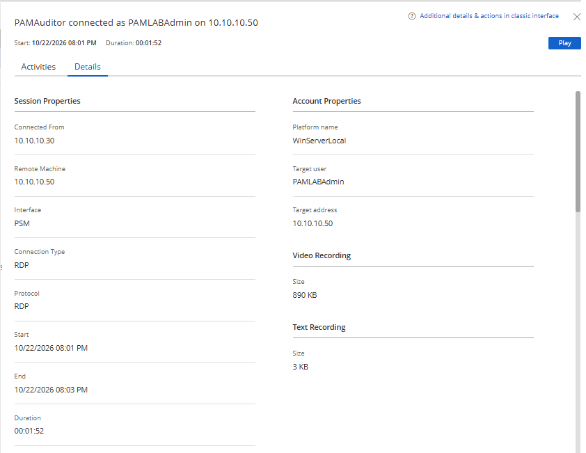
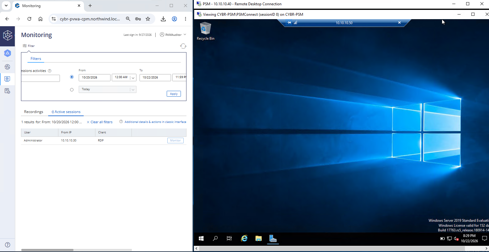

<p align="center">


</p>


<h1>CyberArk PAM - Privileged Access Control and Session Auditing</h1>

In this lab, we configured Safe permissions in CyberArk to allow a user to access a privileged account without being able to retrieve its password. We then connected to a Windows Server through Privileged Session Manager (PSM), reviewed the recorded session and its audit details, and monitored a separate privileged session in real time. This lab demonstrates least-privilege access, credential isolation, and privileged session auditing.

<h2>Environments and Technologies Used</h2>


- Hyper-V (Virtual Machines)
- CyberArk Privileged Access Manager (PAM)
- Password Vault Web Access (PVWA)
- CyberArk Digital Vault and Safe Permissions
- Privileged Session Manager (PSM)
- Remote Desktop Protocol (RDP)
- Windows PowerShell

<h2>Operating Systems Used</h2>

- Windows Server 2019

<h2>High-Level Steps</h2>

- Step 1. Review Safe Permissions
- Step 2. Test Use vs. Retrieve Access
- Step 3. Connect to a Privileged Account Through PSM
- Step 4. Review the Session Recording
- Step 5. Inspect Session Audit Details
- Step 6. Monitor an Active Privileged Session

> [!IMPORTANT]
> Each step includes written instructions followed by a corresponding screenshot. The **See screenshots** sections are expanded by default but can be collapsed.

<h2>Actions and Observations</h2>

<b>1. REVIEW SAFE PERMISSIONS</b>

In PVWA, navigate to the Safe named "Northwind-Windows-Admins" and select the Members tab. Locate the user "PAMAuditor" and open Edit permissions. Under Access, confirm the following settings:

- List accounts: Enabled
- Use accounts: Enabled
- Retrieve accounts: Disabled

Observe that **Use accounts** permission allows the user to connect through PSM, while **Retrieve accounts** controls whether the user can show or copy an account's password. This lets us give the user access to the account without allowing password retrieval.

<details open><summary>See screenshots</summary>



</details>

<b>2. TEST USE VS. RETRIEVE ACCESS</b>

Sign into PVWA as "PAMAuditor" and view the "PAMLABAdmin" account. Select the Details tab and observe the available account actions.

Notice that **Show** and **Copy** are disabled, but **Connect** is available. This confirms that PAMAuditor can use the privileged account through an approved connection without having permission to retrieve the password.

<details open><summary>See screenshots</summary>



</details>

<b>3. CONNECT THROUGH PRIVILEGED SESSION MANAGER (PSM)</b>

While signed into PVWA as "PAMAuditor", select **Connect** on the PAMLABAdmin account and launch the PSM-RDP connection to TARGET01. Once connected, open PowerShell on the target machine and run the following commands:

```powershell
whoami
hostname
```

Observe the output:

```text
target01\pamlabadmin
TARGET01
```

The connection was initiated by PAMAuditor, but the Windows session is running as the managed local administrator account, PAMLABAdmin. Notice the RDP connection also identifies the PSM address "10.10.10.40". The session was established without PAMAuditor viewing or copying the managed password.

<details open><summary>See screenshots</summary>



</details>

<b>4. REVIEW THE SESSION RECORDING</b>

Close the RDP session, return to PVWA, and open **Monitoring**. Under **Recordings**, locate the session initiated by PAMAuditor for PAMLABAdmin on "10.10.10.50". Select **Play** to review the recorded session.

Observe the playback and activity timeline. CyberArk recorded the PowerShell session, including the `whoami` and `hostname` commands. The timeline also shows application activity such as explorer.exe, ServerManager.exe, and powershell.exe.

<details open><summary>See screenshots</summary>



</details>

<b>5. INSPECT SESSION AUDIT DETAILS</b>

From the recording in PVWA Monitoring, open the **Details** tab. Review the session properties and account properties associated with the recording.

Notice the following information:

- Initiating user: PAMAuditor
- Target account: PAMLABAdmin
- Target address: 10.10.10.50
- Connected from: 10.10.10.30
- Interface: PSM
- Connection type and protocol: RDP
- Session start, end, and duration
- Video and text recording information

These details allow us to identify who initiated the privileged connection, which managed account was used, and which system was accessed. The session recording shown in this lab lasted approximately 1 minute and 52 seconds.

<details open><summary>See screenshots</summary>



</details>

<b>6. MONITOR AN ACTIVE PRIVILEGED SESSION</b>

Sign into PVWA as "Administrator" and start a new PSM-RDP session to TARGET01 using the managed PAMLABAdmin account. Leave this session open.

In a separate browser session, sign into PVWA as "PAMAuditor". Navigate to **Monitoring**, select **Active sessions**, and locate the session initiated by Administrator. Select **Monitor** to view the session while it is still active.

Observe that the Active sessions list identifies "Administrator" as the user and shows the RDP client connection from "10.10.10.30". The monitoring window displays the target desktop on "10.10.10.50" in real time.

Unlike Step 4, where we reviewed a completed recording, this step demonstrates monitoring an ongoing privileged session. Administrator initiated the connection, while PAMAuditor monitored it using a separate CyberArk login.

<details open><summary>See screenshots</summary>



</details>

This lab demonstrates how CyberArk separates privileged account usage from password retrieval, while providing recorded session playback, audit details, and live monitoring to help track privileged activity.
